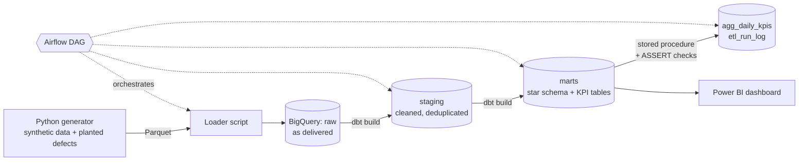
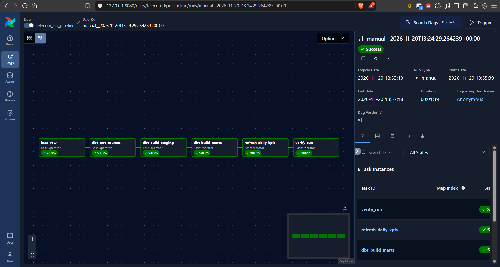
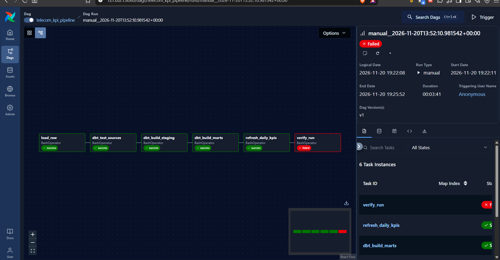
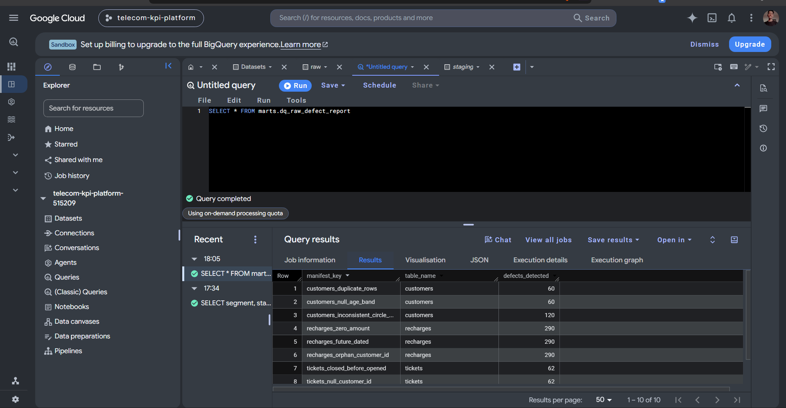
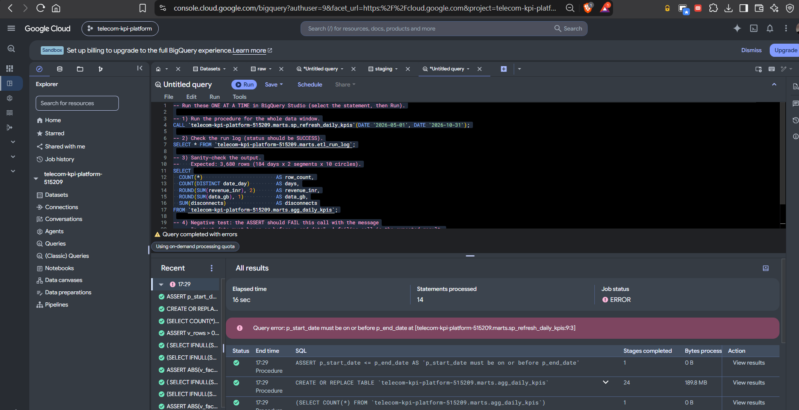
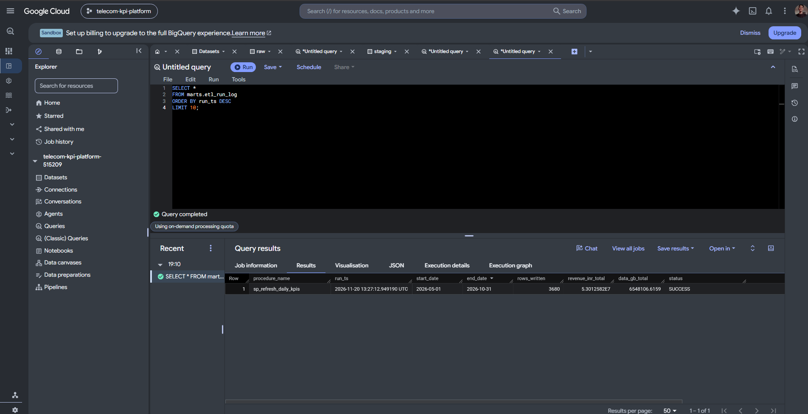
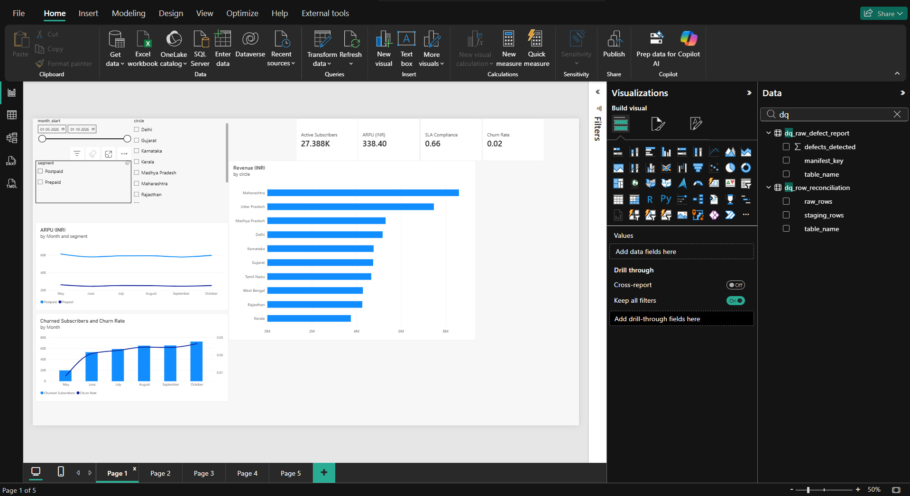
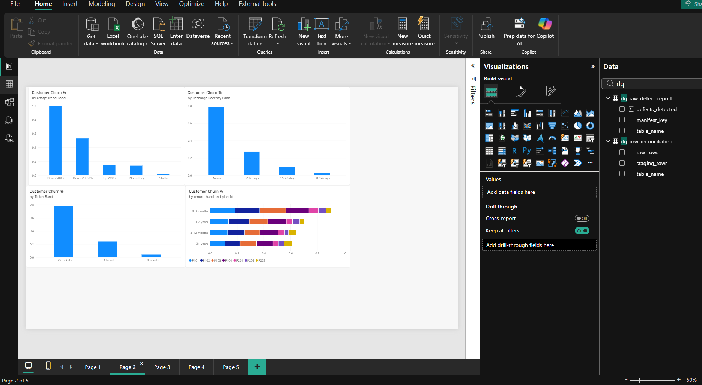

# Telecom KPI Data Platform

An end-to-end analytics platform for a (synthetic) telecom operator. It takes messy operational data, loads
it into **Google BigQuery**, cleans and models it with **dbt**, orchestrates the whole thing with **Airflow**,
guards quality with tests and assertions, and serves ARPU, churn, usage and ticket-SLA KPIs through a
**Power BI** dashboard.

> **Data is 100% synthetic**, produced by `generator/generate_data.py`. It contains deliberate defects and
> planted behaviour patterns so the pipeline has real work to do. Nothing here is real customer data.

## Results at a glance

| What | Result |
|---|---|
| Data volume | ~30K customers, ~4.6M daily usage records, ~145K recharges, ~31K support tickets |
| Data quality | **10 defect types injected, all 10 detected** by the pipeline (e.g. 9,223 duplicate usage rows, 290 orphan recharges, 62 tickets closed before opened) |
| End-to-end pipeline | 6 Airflow tasks, **1 min 39 s** from raw load to verified KPI tables |
| Reconciliation | Total revenue in the KPI layer = ₹53,012,582, matching an independent calculation |
| Query optimisation | Column pruning **-56%** bytes scanned; pre-aggregated table **-99.9%**; clustering **-92%** (see below) |
| Honest null result | Aggregating before a join made compute **worse** (+93% slot time); the optimiser already handles it |

## Architecture



**Pipeline (Airflow DAG `telecom_kpi_pipeline`):**
`load_raw -> dbt_test_sources -> dbt_build_staging -> dbt_build_marts -> refresh_daily_kpis -> verify_run`

A failing step stops everything downstream, so bad data never reaches the reporting tables.

| Successful run | Quality gate stopping a run |
|---|---|
|  |  |

## Tech stack and why

| Tool | Role | Why (short version; full reasoning in [`docs/INTERVIEW_GUIDE.md`](docs/INTERVIEW_GUIDE.md)) |
|---|---|---|
| Python (NumPy + pandas) | Synthetic data generator | Safe, reproducible, lets me plant known defects to test against |
| Parquet | File format | Typed, compressed, columnar; loads into BigQuery without schema guessing |
| **BigQuery** | Warehouse | Serverless, columnar, SQL-first, free sandbox; the cloud platform named in the role |
| **dbt Core** | Transformations + tests | SQL models with version control, dependency graph and built-in testing |
| **Airflow 3** | Orchestration | Industry-standard scheduler with retries, dependencies and a visible run history |
| **Power BI** | Dashboard | Widely used BI tool; semantic model + DAX measures |
| Docker | Local Airflow | Reproducible environment without installing Airflow on Windows |

## Data model

Raw -> staging -> marts. The marts hold a star schema plus pre-aggregated KPI tables.
Full ER diagram, KPI definitions and column-level documentation:
[`docs/DATA_MODEL.md`](docs/DATA_MODEL.md) and [`docs/DATA_DICTIONARY.md`](docs/DATA_DICTIONARY.md).

## Data quality approach

1. **Detect in raw** (dbt source tests, severity *warn*): record defects without stopping the run.
2. **Fix in staging**: deduplicate, standardise, quarantine invalid rows (excluded, counted, never silently altered).
3. **Prove it** (dbt tests, severity *error*): staging and marts must pass or the pipeline stops.
4. **Reconcile**: `dq_raw_defect_report` and `dq_row_reconciliation` compare raw vs staging counts; the stored
   procedure `ASSERT`s that its output matches the fact tables.

All injected defects were found, with counts matching the generator's manifest:



## Stored procedure with validation

`sql/sp_refresh_daily_kpis.sql` rebuilds the daily KPI table and fails the whole run if revenue or data volume
does not reconcile. A deliberately invalid call (start date after end date) is rejected by its `ASSERT`:



The run log written by the successful run (3,680 rows = 184 days x 2 segments x 10 circles):



## Dashboard

| Overview | Behaviour before churn |
|---|---|
|  |  |

> The churn page shows behaviour in the 30 days **before disconnect**. The synthetic generator plants those
> patterns, so this demonstrates the analysis, not a predictive finding.

Build steps and DAX: [`docs/POWERBI_GUIDE.md`](docs/POWERBI_GUIDE.md).

## SQL optimisation (measured)

Four query pairs benchmarked with the cache disabled; each optimised query returns identical results to its
baseline (verified in the script). Details and method: [`docs/SQL_OPTIMISATION.md`](docs/SQL_OPTIMISATION.md).

| Case | Technique | Bytes scanned | Compute (slot-s) |
|---|---|---|---|
| A | Select only needed columns | 271.6 -> 119.7 MB (**-56%**) | 2.34 -> 1.35 |
| B | Query pre-aggregated table | 120.3 -> 0.1 MB (**-99.9%**) | 0.43 -> 0.01 |
| C | Aggregate before join | 120.6 -> 120.6 MB (no change) | 0.40 -> 0.77 (**worse**) |
| D | Clustered table, single-customer lookup | 156.5 -> 13.1 MB (**-92%**) | 0.45 -> 0.03 |

Case C is reported on purpose: not every "optimisation" helps, and measuring is how you find out.

## Run it yourself

```bash
python -m venv .venv && .venv\Scripts\activate          # Windows
pip install -r requirements.txt
python generator/generate_data.py --customers 30000 --out data/raw
python ingestion/load_to_bigquery.py --project <your-project-id>
cd dbt/telecom_kpi && dbt build --profiles-dir .
```

For the scheduled pipeline use Docker: see [`docs/AIRFLOW_SETUP.md`](docs/AIRFLOW_SETUP.md).
GCP and billing guardrails: [`docs/GCP_SETUP.md`](docs/GCP_SETUP.md). Operating and troubleshooting:
[`docs/RUNBOOK.md`](docs/RUNBOOK.md).

## Design decisions under the BigQuery sandbox (no billing account)

| Sandbox limit | Response |
|---|---|
| No DML (`INSERT`/`UPDATE`/`MERGE`) | `table` materialisations rebuilt with `CREATE OR REPLACE TABLE`; no incremental models |
| No scheduled queries | Airflow schedules the pipeline |
| Tables expire after 60 days | Pipeline is idempotent; one run rebuilds everything and resets expiry |
| Default partition expiry would drop old partitions | Tables are clustered, not date-partitioned |

Verified in this project: DDL, `CREATE PROCEDURE`, `CREATE TABLE AS SELECT` inside procedures, and load jobs all work in the sandbox.

## Limitations and next steps

- Synthetic data; ARPU is cash-basis and not calibrated to real market figures.
- The generator does not create disconnects in the first 20 days of the window, so May churn is understated.
- Local single-container Airflow with no authentication is a demo setup, not production.
- Next: date partitioning and incremental models (needs billing), CI that runs `dbt build` on pull requests,
  `dbt docs` lineage site, Slack/email alerting, a churn model on the 360-degree customer table.

## Repository layout

```
generator/      synthetic data generator
ingestion/      BigQuery loader, procedure runner, run verification, export fallback
dbt/telecom_kpi dbt project: staging, marts, monitoring models, tests
sql/            stored procedure and run/verify scripts
orchestration/  Airflow DAG, Dockerfile, docker-compose
benchmarks/     SQL optimisation benchmark and results
docs/           guides, data model, data dictionary, runbook, interview guide
```
