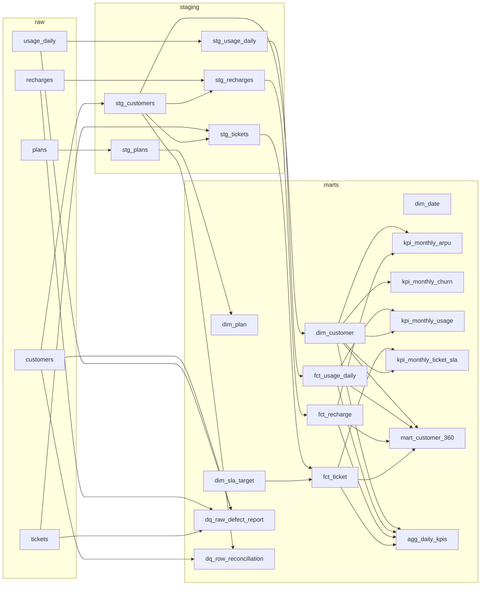

# Data dictionary and lineage

## Lineage

`agg_daily_kpis` and `etl_run_log` are created by the stored procedure, not by dbt.

## Raw layer (dataset `raw`): exactly as delivered, defects included

| Table | Grain | Columns |
|---|---|---|
| `plans` | one per plan | plan_id, plan_name, plan_type (Prepaid/Postpaid), price_inr, validity_days, data_gb_total |
| `customers` | one per customer (duplicates present) | customer_id, segment, plan_id, signup_date, circle, age_band, device_type, acquisition_channel, disconnect_date, status |
| `usage_daily` | customer x day | customer_id, usage_date, data_mb, voice_minutes, sms_count, roaming_flag |
| `recharges` | one per recharge / bill payment | recharge_id, customer_id, recharge_date, amount_inr, channel, payment_status |
| `tickets` | one per support ticket | ticket_id, customer_id, opened_ts, closed_ts, category, priority, channel, status, csat_score |

### Planted defects (detected by `marts.dq_raw_defect_report`)

| manifest_key | Count | Handling in staging |
|---|---|---|
| customers_duplicate_rows | 60 | Keep one row per customer (prefer the copy with known age_band) |
| customers_inconsistent_circle_casing | 120 | `INITCAP(TRIM(circle))` |
| customers_null_age_band | 60 | Replace with `'Unknown'` |
| usage_duplicate_rows | 9,223 | Keep one row per customer-day |
| usage_negative_data_mb | 9,223 | Quarantine (row excluded) |
| recharges_orphan_customer_id | 290 | Quarantine (customer does not exist) |
| recharges_zero_amount | 290 | Quarantine |
| recharges_future_dated | 290 | Quarantine (after data window end) |
| tickets_null_customer_id | 62 | Quarantine |
| tickets_closed_before_opened | 62 | Quarantine |

## Staging layer (dataset `staging`): cleaned, typed, one model per source

Same columns as raw, plus: `stg_customers.is_churned`, `stg_recharges.is_paid`,
`stg_tickets.resolution_hours` (timestamps converted to TIMESTAMP).

## Marts (dataset `marts`)

### Dimensions

| Table | Grain / key | Notable columns |
|---|---|---|
| `dim_customer` | customer_id | segment, plan_id, signup_date, signup_month, circle, age_band, device_type, acquisition_channel, disconnect_date, status, is_churned, tenure_days, tenure_band |
| `dim_plan` | plan_id | plan_name, plan_type, price_inr, validity_days, data_gb_total, price_per_day_inr |
| `dim_date` | date_key (YYYYMMDD) | date_day, calendar_year, calendar_quarter, month_num, month_name, month_start, week_start, day_name, is_weekend |
| `dim_sla_target` | priority | sla_hours (P1 4, P2 24, P3 72), priority_label |

### Facts

| Table | Grain | Measures |
|---|---|---|
| `fct_usage_daily` (clustered by customer_id) | customer x day | data_mb, data_gb, voice_minutes, sms_count, roaming_flag |
| `fct_recharge` | one payment | amount_inr, revenue_inr (paid only), is_paid, payment_status |
| `fct_ticket` | one ticket | resolution_hours, sla_hours, is_sla_breached, csat_score |

`is_sla_breached`: closed tickets resolved slower than target; open tickets already older than target at the data window end.

### KPI tables (read by Power BI)

| Table | Grain | Columns |
|---|---|---|
| `kpi_monthly_arpu` | month x segment x circle | active_subscribers, revenue_inr, arpu_inr, paid_transactions, failed_transactions, payment_failure_rate |
| `kpi_monthly_churn` | month x segment x circle | opening_subscribers, gross_adds, churned_subscribers, closing_subscribers, churn_rate |
| `kpi_monthly_usage` | month x segment x circle | total_data_gb, total_voice_minutes, total_sms, subscriber_days, active_users, avg_data_mb_per_sub_day, avg_voice_min_per_sub_day, roaming_days |
| `kpi_monthly_ticket_sla` | month x priority x category x segment | tickets, closed_tickets, open_tickets, sla_breached_tickets, sla_compliance_rate, avg_resolution_hours, avg_csat, csat_responses |
| `mart_customer_360` | customer | as_of_date, data_mb_last_30d, data_mb_prev_30d, data_usage_change_pct, voice_min_last_30d, last_recharge_date, days_since_last_recharge, tickets_last_30d, sla_breaches_last_30d |
| `agg_daily_kpis` (procedure) | day x segment x circle | active_subscribers, gross_adds, disconnects, data_gb, voice_minutes, sms_count, revenue_inr, paid/failed_transactions, tickets_opened, tickets_sla_breached |

### Monitoring

| Table | Purpose |
|---|---|
| `dq_raw_defect_report` | Count of each planted defect type found in raw |
| `dq_row_reconciliation` | Raw vs staging row counts per table |
| `etl_run_log` | Latest stored-procedure run: status, rows, totals (replaced each run; sandbox has no INSERT) |

## KPI definitions

- **Active subscriber (month):** signed up on or before month end and not disconnected before month start.
- **ARPU:** successful payments in the month / active subscribers (cash basis; prepaid packs longer than 28 days make it lumpy).
- **Churn rate:** disconnects in month / (opening subscribers + gross adds in month).
- **SLA compliance:** 1 - (breached tickets / tickets).
- **CSAT:** average 1-5 score among tickets with a response (about 45% respond).
