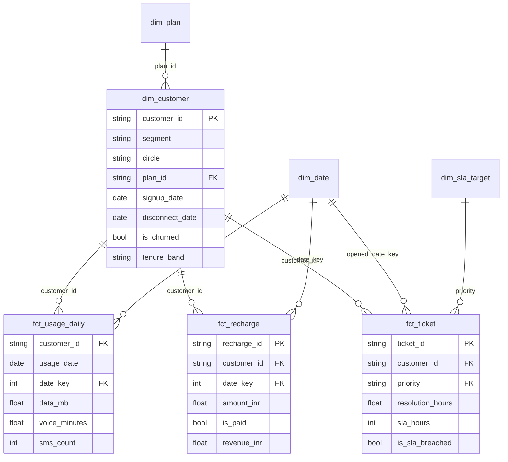

# Data model

## Layers

| Layer (BigQuery dataset) | Purpose | Built by |
|---|---|---|
| `raw` | Source exports exactly as delivered (defects included) | `ingestion/load_to_bigquery.py` |
| `staging` | Cleaned, deduplicated, typed, one model per source table (`stg_*`) | dbt |
| `marts` | Star schema (`dim_*`, `fct_*`), KPI tables (`kpi_*`), customer 360, DQ reports | dbt |

## Star schema

## KPI tables (read by Power BI)

| Table | Grain | Key measures |
|---|---|---|
| `kpi_monthly_arpu` | month x segment x circle | active_subscribers, revenue_inr, arpu_inr, payment_failure_rate |
| `kpi_monthly_churn` | month x segment x circle | opening_subscribers, gross_adds, churned_subscribers, closing_subscribers, churn_rate |
| `kpi_monthly_usage` | month x segment x circle | total_data_gb, avg_data_mb_per_sub_day, total_voice_minutes, roaming_days |
| `kpi_monthly_ticket_sla` | month x priority x category x segment | tickets, sla_compliance_rate, avg_resolution_hours, avg_csat |
| `mart_customer_360` | customer | usage change last 30d vs previous 30d, days since last recharge, tickets and SLA breaches in last 30d |

## KPI definitions

- **Active subscriber (month):** signed up on or before month end and not disconnected before month start.
- **ARPU:** successful recharge / bill payments in the month divided by active subscribers. Cash basis, so
  prepaid packs longer than 28 days make it lumpy.
- **Churn rate:** disconnects in month / (opening subscribers + gross adds in month).
- **SLA breach:** closed ticket resolved slower than its priority target; open ticket already older than its target
  at the end of the data window. Targets are in `dim_sla_target` (P1 4h, P2 24h, P3 72h).
- **mart_customer_360 snapshot date:** disconnect date for churned customers (so we see behaviour before they left),
  end of data window for active customers.

## Known limitations of the synthetic data

- The generator does not place disconnects in the first 20 days of the window, so May churn is understated.
  Read churn trends from June onwards.
- Data is synthetic; ARPU is not calibrated to real market figures.
